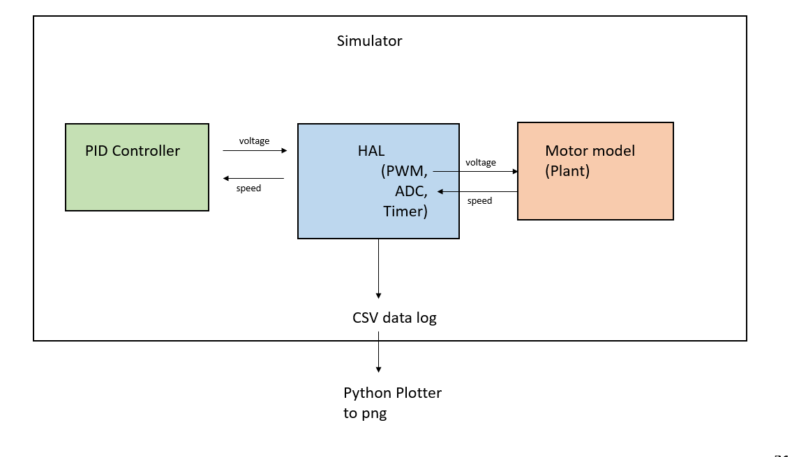
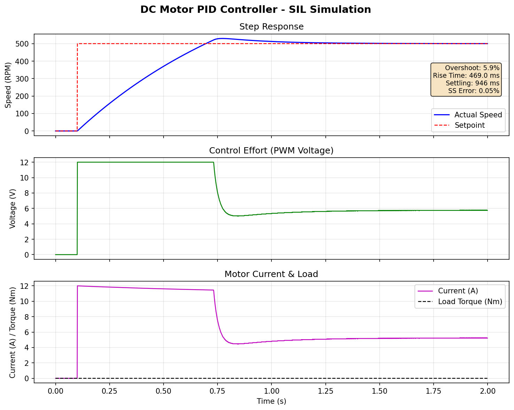
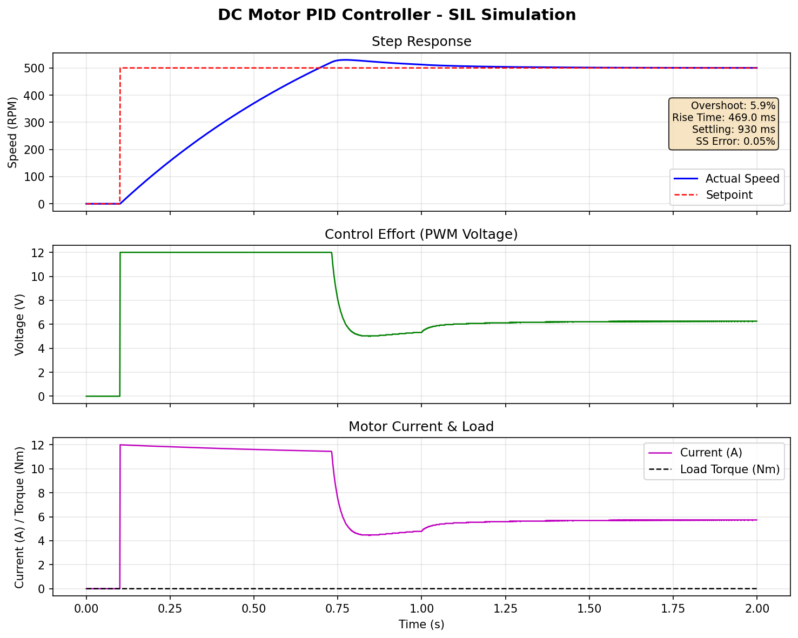

# DC Motor PID Controller — Software-in-the-Loop Simulation

A pure C embedded-style project that simulates a DC motor with a PID speed controller, using a Hardware Abstraction Layer (HAL) to decouple firmware from hardware — the same architecture used in automotive and electric drive systems for testing control software before deploying to a microcontroller.

## Overview

In industry, control firmware is developed and validated in simulation before it runs on real hardware. This project demonstrates that workflow:

- **Plant Model** — DC motor with back-EMF, inertia, and friction (Euler integration)
- **PID Controller** — Embedded-style C with anti-windup, derivative filtering, and output saturation
- **HAL** — Simulated ADC, PWM, timers, and GPIO that mirror real microcontroller peripherals
- **Simulator** — Connects controller to plant through HAL, logs all signals to CSV
- **Python Plotter** — Generates step response, control effort, and current plots with performance metrics

The controller code (`pid_controller.c`, `hal.c`) is written exactly as it would be for a microcontroller: no dynamic allocation, fixed-size types, struct-based C99. Only the simulator layer uses `malloc` for data logging.

## Architecture



## Project Structure

```
motor-control-sil/
├── CMakeLists.txt
├── include/
│   ├── motor_model.h        # DC motor plant model
│   ├── pid_controller.h     # PID controller (embedded-style)
│   ├── hal.h                # Hardware Abstraction Layer
│   └── simulator.h          # SIL simulator
├── src/
│   ├── main.c               # CLI entry point with argument parsing
│   ├── motor_model.c        # Motor dynamics (back-EMF, inertia, friction)
│   ├── pid_controller.c     # PID with anti-windup and derivative filter
│   ├── hal.c                # Simulated ADC, PWM, timer peripherals
│   └── simulator.c          # Simulation loop, logging, performance metrics
└── scripts/
    └── plot_response.py     # Matplotlib visualization
```

## Motor Model

Simplified DC motor equations (neglecting armature inductance):

```
Current:        i = (V - Ke * ω) / R
Motor Torque:   T = Kt * i
Acceleration:   J * dω/dt = T - B * ω - T_load
```

Default parameters (typical small DC motor):

| Parameter | Symbol | Value | Unit |
|-----------|--------|-------|------|
| Armature Resistance | R | 1.0 | Ω |
| Back-EMF Constant | Ke | 0.01 | V/(rad/s) |
| Torque Constant | Kt | 0.01 | Nm/A |
| Rotor Inertia | J | 0.001 | kg·m² |
| Viscous Friction | B | 0.001 | Nm·s/rad |
| Supply Voltage | V_max | 12.0 | V |

## PID Controller Features

- **Anti-windup** — Integral term clamped to prevent saturation overshoot
- **Derivative filter** — Low-pass filter on D term to suppress noise amplification
- **Output saturation** — Clamped to [0, V_max] matching real PWM limits
- **Runtime tuning** — Gains adjustable via command-line arguments
- **No dynamic allocation** — Suitable for direct deployment on microcontroller

## Build

```bash
git clone https://github.com/YOUR_USERNAME/motor-control-sil.git
cd motor-control-sil
mkdir build && cd build
cmake ..
make
```

Requirements: C compiler (GCC), CMake 3.16+, Python 3 with matplotlib (for plotting).

## Usage

Run with default parameters (500 RPM step input):

```bash
./MotorControlSIL
```

Custom PID gains and target speed:

```bash
./MotorControlSIL -kp 0.8 -ki 3.0 -kd 0.002 -rpm 600
```

With load disturbance (0.005 Nm applied at t=1.0s):

```bash
./MotorControlSIL -load 1.0 0.005 -o output_load.csv
```

Generate plots:

```bash
python3 ../scripts/plot_response.py output.csv
```

### All Options

```
  -kp <value>              Proportional gain (default: 0.5)
  -ki <value>              Integral gain (default: 2.0)
  -kd <value>              Derivative gain (default: 0.001)
  -rpm <value>             Target speed in RPM (default: 500)
  -t <value>               Simulation duration in seconds (default: 2.0)
  -load <time> <torque>    Load disturbance at time (Nm)
  -o <filename>            Output CSV file (default: output.csv)
```

## Performance Metrics

The simulator automatically computes and prints:

```
===== PERFORMANCE SUMMARY =====
  Target Speed:    500.0 RPM
  Steady-State:    500.2 RPM
  SS Error:        0.05%
  Peak Speed:      529.7 RPM at t=0.7720s
  Overshoot:       5.9%
  Rise Time:       0.4690s
  Settling Time:   0.9460s (2% band)
===============================
```

## Screenshots

### Step Response


### Load Disturbance Rejection


## License

MIT License
